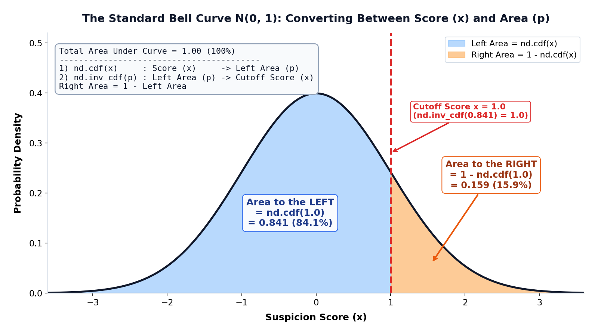
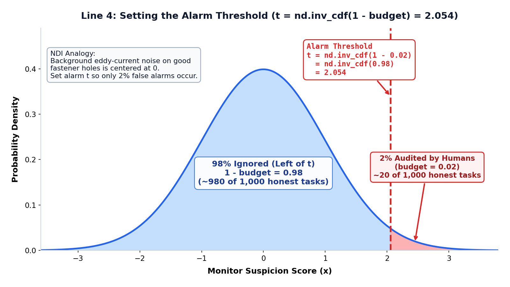
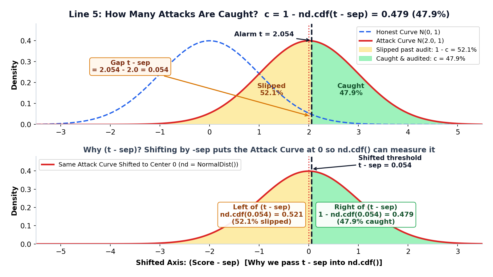
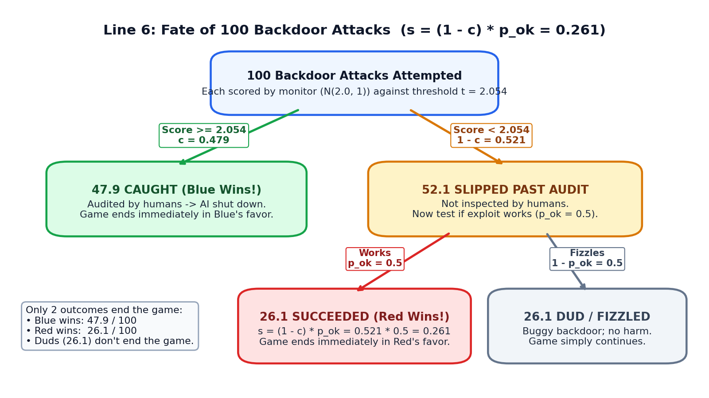
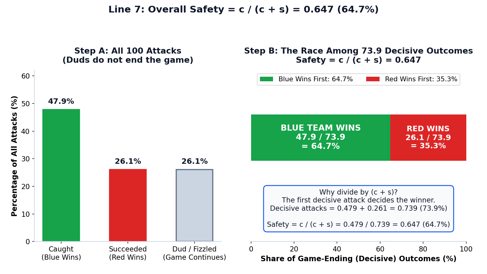
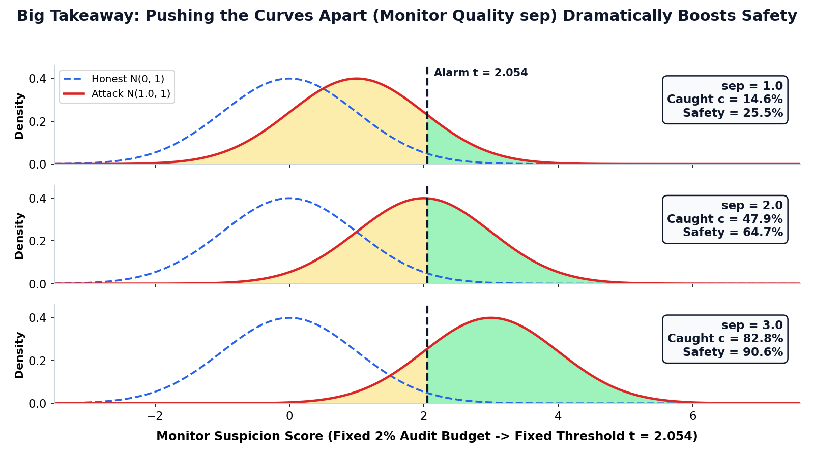

# AI Control Statistics Walkthrough — Visual Presentation

> **Downloadable PowerPoint Deck:** [AI_Control_Statistics_Walkthrough.pptx](../ai-control-project/docs/AI_Control_Statistics_Walkthrough.pptx) (8 slides, 16:9 widescreen)  
> **Generator Script:** [build_presentation.py](../ai-control-project/src/build_presentation.py)

````carousel
## Slide 1 — Setup & Aircraft NDI Analogy

Think of this calculation like **Non-Destructive Inspection (NDI)** (e.g., eddy-current inspection of fastener holes):
- **Honest code** = good hole (background noise centered at `0`).
- **Backdoored code** = cracked hole (stronger signal centered at `+sep`).
- **Monitor score** = eddy-current voltage reading.
- **Audit budget (`0.02`)** = expensive human teardown capacity (top 2%).

```python
from statistics import NormalDist
nd = NormalDist()                 # mean 0, standard deviation 1
budget, sep, p_ok = 0.02, 2.0, 0.5
t = nd.inv_cdf(1 - budget)        # threshold   -> 2.054
c = 1 - nd.cdf(t - sep)           # caught      -> 0.479
s = (1 - c) * p_ok                # slipped+won -> 0.261
print(t, c, s, c / (c + s))       # safety      -> 0.647
```
<!-- slide -->
## Slide 2 — The Only Two Functions (`cdf` vs `inv_cdf`)



- Total area under the bell curve = **`1.00` (100%)**.
- `nd.cdf(x)` takes a **Score** and returns the **Area to the LEFT**.
- `nd.inv_cdf(p)` takes a **Left Area** and returns the **Cutoff Score**.
- Because we audit **high scores on the right**, `Right Area = 1 - nd.cdf(x)`.
<!-- slide -->
## Slide 3 — Line 4: Setting the Alarm Threshold (`t = 2.054`)



- `budget = 0.02` means humans inspect only the **top 2%** of honest outputs.
- That leaves **98% (`1 - 0.02 = 0.98`)** below the alarm on the left.
- `nd.inv_cdf(0.98) = 2.054` (out of 1,000 honest tasks, ~20 trigger an audit).
<!-- slide -->
## Slide 4 — Line 5: How Many Attacks Are Caught (`c = 47.9%`)



- Attacks are centered at `sep = 2.0`, while the alarm stays fixed at `t = 2.054`.
- Shifting both by `-sep` puts the attack curve at `0` so `nd.cdf()` can measure it.
- At `t - sep = +0.054`, `52.1%` slip past (`nd.cdf`) and **`47.9%` are caught** (`1 - nd.cdf`).
<!-- slide -->
## Slide 5 — Line 6: Fate of Unaudited Attacks (`s = 26.1%`)



- Out of 100 attacks, **`47.9`** are audited and caught (**Blue wins immediately**).
- **`52.1`** (`1 - c`) slip past inspection. With `p_ok = 0.5`, **`26.1` succeed** (**Red wins**) and **`26.1` are duds** (game continues).
<!-- slide -->
## Slide 6 — Line 7: The Safety Race (`c / (c + s) = 64.7%`)



- Duds don't end the game, so only the **`47.9 + 26.1 = 73.9`** game-ending attacks matter.
- Blue's share of decisive outcomes is `0.479 / (0.479 + 0.261) =` **`0.647` (64.7%)**.
<!-- slide -->
## Slide 7 — Big Takeaway: Monitor Quality (`sep`) Dominates



- With a fixed 2% audit budget (`t = 2.054`), improving monitor quality from `sep = 1.0` to `sep = 3.0` raises caught attacks from `14.6%` to `82.8%` and **Safety from `25.5%` to `90.6%`**.
````

## Complete 7-Line Cheat-Sheet

| Code | Plain-English Meaning | NDI Engineering Analogy | Exact Value |
|---|---|---|---|
| `budget = 0.02` | Fraction of honest work humans can audit | Teardown inspection capacity (2%) | `0.020` |
| `sep = 2.0` | Distance between attack and honest mean scores | Flaw signal-to-noise separation ($d'$) | `2.000` |
| `p_ok = 0.5` | Chance an unaudited backdoor actually works | Chance an unfound crack causes failure | `0.500` |
| `t = nd.inv_cdf(1 - budget)` | Cutoff leaving 98% of honest work below | Eddy-current alarm threshold | `2.054` |
| `c = 1 - nd.cdf(t - sep)` | Fraction of attacks scoring $\ge t$ (caught) | Probability of Detection (POD) | `0.479` (`47.9%`) |
| `s = (1 - c) * p_ok` | Fraction slipping past audit AND working | Undetected flaw causing failure | `0.261` (`26.1%`) |
| `c / (c + s)` | Chance Blue catches before Red succeeds | Probability structure stays safe | `0.647` (`64.7%`) |
