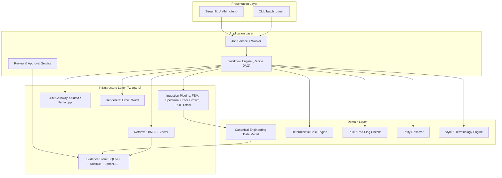
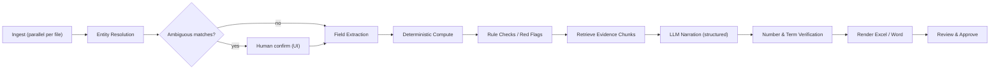
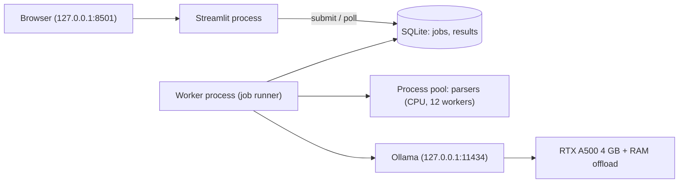

# F&DT-LocalAI: Software Architecture Specification

**Document Version:** 2.0.0
**Companion documents:** [PROJECT_PLAN.md](PROJECT_PLAN.md) (scope, roadmap, risks) · [README.md](README.md) (overview, quickstart)

---

## 1. Architecture Review Findings (v1.2 → v2.0)

The v1.2 plan described *features* well but left several *structural* gaps. Some of them would have blocked delivery. This table lists each finding and how v2.0 resolves it.

| # | Finding in v1.2 | Impact | v2.0 Resolution |
| :-- | :--- | :--- | :--- |
| F1 | **Context budget contradiction.** Map phase sends "50-page sections" to the LLM, but 50 pages ≈ 25k–40k tokens while the runtime is capped at 4k–8k tokens. | The pipeline as written cannot run. | **Extract-then-reason:** deterministic extraction first, then section-aware retrieval feeds the LLM chunks of ≤ 3k tokens (§6). |
| F2 | **KV-cache sizing error.** Phi-3.5-mini has no grouped-query attention (32 KV heads), so its KV cache at 8k tokens is ~3.0 GB FP16, not 0.5 GB. With its ~2.4 GB of weights, that exceeds 4 GB VRAM. | Out-of-memory errors or a silent fall-back to CPU. | Model tiers re-selected using GQA models. KV cache quantised to q8. Context capped per tier (§9). |
| F3 | **No canonical data model.** Each parser emits its own ad-hoc JSON. | Cross-referencing, provenance and Excel output all become brittle. | A **Canonical Engineering Data Model** (Pydantic) is the single contract between layers (§4). |
| F4 | **No units handling.** MPa, ksi, psi, mm and in are mixed across legacy reports. | Silent errors of 6.9× (ksi vs MPa) or 25.4× (in vs mm). These are the most dangerous F&DT errors. | Every number is a `Quantity` with an explicit unit (`pint`). Conversion happens at ingestion and mixed units are rejected (§4.3). |
| F5 | **The "current requirement" is not modelled.** The original scope says *"summarise results as per any current requirement"*, but no component represents the request itself. | Every new request means ad-hoc prompting, so results are not repeatable. | **Task Recipes:** versioned YAML specs that declare inputs, fields to extract, checks and the output template (§5). |
| F6 | **Reinventing mature parsers.** Hand-written regex for Nastran BDF/F06. | Weeks of effort and edge-case bugs (continuation cards, large-field format). | Use **pyNastran** (BDF/OP2/F06) and the **rainflow** package. Custom code only for in-house formats (§3.2). |
| F7 | **Streamlit runs long jobs in-process.** | The UI freezes, a page refresh loses progress, and a crash loses the run. | A **background job worker** with SQLite-persisted job state. Streamlit becomes a thin client (§7). |
| F8 | **No persistent evidence store.** Intermediate results live in JSON scratch files. | No querying, no resume, a weak audit trail. | **Evidence Store:** SQLite (metadata, provenance) + DuckDB/Parquet (large numeric tables) + LanceDB (text index) (§4.4). |
| F9 | **No reproducibility record.** Outputs are not tied to model, prompt or code versions. | Results cannot be defended in a certification audit. | A **Run Manifest** stores input hashes, model SHA-256, prompt versions, code version, seed and temperature (§8.2). |
| F10 | **No quality measurement.** Claims like "100% accuracy" were never measured. | Regressions go unnoticed when a model or prompt changes. | An **offline evaluation harness** with a golden dataset and field-level metrics, run on every change (§10). |
| F11 | **Excel edge cases.** `openpyxl` cannot read `.xls`. `data_only=True` returns only values cached by Excel and never recalculates. | Missing or stale values from calc sheets. | `xlrd` for `.xls`. Stale or uncached formulas are detected and flagged. Optional headless LibreOffice recalculation (offline) (§3.4). |
| F12 | **Output limited to Excel.** The style-fidelity requirement applies to *report prose*, which usually goes into Word or PDF. | Narrative summaries are stuck in Excel cells. | Template-driven renderers: Excel (primary) plus optional Word `.docx` built from the user's own report template (§5.3). |
| F13 | **Licensing not considered.** | Some model licences restrict corporate use (e.g. Qwen2.5-3B uses a research licence). | A licence column is added to the model matrix and only permissive licences are allowed by default (§9). |
| F14 | **Overstated guarantees** ("zero hallucination", "Residual Risk: Zero"). | False assurance in a safety-related domain. | Reworded as **controls plus verification**. Residual risk is stated honestly in the risk register. |
| F15 | **Model tier sizing & GQA.** Phi-3.5-mini dropped due to MHA memory blowup. Gemma 2 2B evaluated. | 4 GB VRAM headroom requires sub-2GB weights + small KV cache. | **Gemma 2 2B Instruct** selected as primary `fast` tier (~1.6 GB, 4-head GQA, <2.0 GB VRAM total at 8k ctx). Qwen 2.5 7B retained for reasoning (§9). |
| F16 | **The PDF table & semantic entity traps.** Automated arbitrary PDF table extraction & purely lexical fuzzy matching fail in real aerospace reports. | Extraction errors and broken cross-document links. | **Assisted table extraction** with UI preview & Blueprint caching (§3.3); **Two-layer entity resolution** separating lexical aliases from semantic component maps (`cross_ref.yaml`) (§4.2). |
| F17 | **Release 1.0 focus & UI simplicity.** Initial scope was too broad across generic documents. Users need immediate, rock-solid replacement of 21 fragile VBA macros in `Spectrum/` via a familiar, simple Excel-form-style interface without intimidating dashboards. | High user friction and delayed delivery. | **Refocused Release 1.0 strictly on the Spectrum Engine** (SPECTRUM inputs/outputs, X900 unrolling, coincident GAG, C-Spec) with dual-mode Excel output (live formulas vs static values) and an ultra-simple form UI (§3.2, §5.3). |

---

## 2. Architecture Principles

1. **Numbers never originate from the LLM.** All numeric values come from deterministic parsers or the calculation engine. The LLM only selects, labels and narrates values it has been given, and a deterministic check verifies every number it outputs.
2. **Provenance is a first-class field, not a log line.** Every value carries `{file_sha, page/line/cell, extractor, extractor_version}` from ingestion through to the output cell.
3. **Core is UI-agnostic.** The engine is a Python library with a CLI. Streamlit is one adapter, so batch runs, tests and a future UI reuse the same core.
4. **Plugins over conditionals.** Parsers, checks, renderers and model backends register through interfaces. Adding a new spectrum format means adding one file, not editing the orchestrator.
5. **Explicit workflow, not autonomous agents.** The orchestrator runs a fixed, inspectable DAG defined by a Task Recipe. There are no free-roaming agent loops, which keeps runs predictable on a 4 GB GPU and auditable.
6. **Human approval gates.** Extracted → Reviewed → Approved states. Nothing is exported as "approved" without an engineer action.
7. **Offline by construction.** No component has a network code path at runtime. Dependencies and models are provisioned once from an offline wheelhouse and a verified model store.

---

## 3. Layered Architecture



### 3.1 Ingestion Plugin Contract

Every parser implements the same interface and returns canonical objects only:

```python
class IngestionPlugin(Protocol):
    name: str                      # e.g. "nastran_f06"
    version: str                   # recorded in provenance
    def sniff(self, path: Path) -> float: ...        # 0..1 confidence this plugin handles the file
    def parse(self, path: Path, ctx: IngestContext) -> IngestResult: ...
    # IngestResult = entities, quantities, tables, text_blocks, warnings (all with Provenance)
```

The plugin registry calls `sniff()` on every file and routes it to the highest-confidence plugin. If two plugins return similar scores, the user is asked to choose.

### 3.2 Ingestion Plugins: Build vs. Reuse

| Input | Library (reuse) | Custom code needed | Notes |
| :--- | :--- | :--- | :--- |
| Nastran `.bdf/.dat` | **pyNastran** `BDF` | Element-group → component mapping | Handles small/large field and continuation cards. |
| SPECTRUM `project_file` | custom text/regex parser | Transfer function syntax checker (`Q01 = -1* EF(11,F)`) | Maps load URLs, parameters, stress equations & output channels. |
| `.nrang.out` / `.rang.out` | **numpy** / **polars** / **pandas** | Fast space-delimited vector reader | Parses 10-col cycle pairs, applies 'S' switch logic, and unrolls X900 points. |
| Coincident GAG Extractor | **duckdb** / relational join | Correlates peak GAG in `*_FBRG.rang.out` with FX & FY | Solves coincident bearing load extraction at peak X900 flight point. |
| Patran `.rpt` | custom token parser | Load printout to `.elfo` conversion | Translates FE load files into standard SPECTRUM `.elfo`/`.endl` decks. |
| Nastran results | **pyNastran** `OP2` (preferred), `F06` | Load-case naming | OP2 is binary and exact. F06 is the fallback. |
| Abaqus | `.inp` / `.dat` / `.rpt` text parsing | Yes (text parser) | `.odb` is **out of scope** because it needs the licensed Abaqus Python API. Export `.rpt` instead. |
| Stress spectra | `pandas`, **rainflow** | In-house format readers | Rainflow counting, exceedance and R-ratio are computed deterministically. |
| Crack growth (NASGRO/AFGROW) | text parsing | Yes, per output format | Version-specific readers are registered as separate plugins. |
| Digital PDF | **PyMuPDF**, **pdfplumber** | Section/TOC detector, table post-processing | Assisted table extraction with UI preview & Blueprint caching. |
| Excel `.xlsx/.xlsm` | **openpyxl** (`keep_vba=True` for read-only metadata) | Named-range, table discovery & live formula engine | Macros are **never executed**. Writes live formulas (=IF, =SQRT). |
| Excel `.xls` | **xlrd** | — | Legacy binary format. |

### 3.3 Digital PDF Pipeline & Assisted Table Extraction

1. **Text-layer check.** A page with no extractable text is flagged as `non_digital` and the document is rejected or partially processed (preventing OCR distortion).
2. **Structure recovery.** Uses PDF bookmarks/outline if present. Otherwise headings are detected from font size and weight plus numbering patterns (`3.2.1`).
3. **Page-batch streaming.** Pages are processed in batches (default 100) through a process pool, so memory stays flat (peak RAM ≤ 2 GB) for documents of any length.
4. **Assisted Table Extraction (Fixing the PDF Trap):**
   - `pdfplumber` vector algorithms extract candidate tables and bounding boxes.
   - For multi-line headers or merged columns, the Streamlit UI provides a **1-click Table Preview** where the engineer verifies or adjusts column dividers.
   - The approved column layout is saved into `blueprints/<report_family>.yaml`. Subsequent reports in that family extract 100% deterministically without human re-review.
5. **Chunking.** Text is split by section boundaries (not fixed page counts) into chunks of ≤ 800 tokens, each tagged with `section_path`, page range and table references.

### 3.4 Excel Ingestion Details

- Read both formula text (`data_only=False`) and cached values (`data_only=True`).
- **Stale-value detection:** a formula cell with no cached value is flagged `UNCACHED`. The engine never trusts the value silently.
- Optional recalculation through headless LibreOffice (`soffice --headless --convert-to xlsx`), which runs fully offline.
- Styles (fonts, fills, number formats, column widths) are captured into a `SheetStyleProfile` that the renderer reuses.

---

## 4. Canonical Engineering Data Model

### 4.1 Core Entities (Pydantic v2)

```python
class Provenance(BaseModel):
    file_sha256: str
    file_name: str
    locator: str               # "p.142 L18" | "Sheet1!D24" | "F06 SUBCASE 3 line 10552"
    extractor: str             # plugin name
    extractor_version: str

class Quantity(BaseModel):
    value: float
    unit: str                  # pint-compatible, e.g. "MPa", "ksi", "cycles", "mm"
    provenance: Provenance

class StructuralLocation(BaseModel):
    canonical_id: str          # e.g. "RIB4_LF_E10423"
    aliases: list[str]         # "CQUAD4 10423", "Elem-10423", "R4_LF_10423"
    component: str | None
    material: str | None       # "AL 7050-T7451"

class LoadCase(BaseModel):
    canonical_id: str
    aliases: list[str]
    category: Literal["limit", "ultimate", "fatigue", "dt", "test", "other"]

class Result(BaseModel):
    location_id: str
    load_case_id: str | None
    kind: Literal["stress", "life", "ms", "kt", "crack_size", "inspection_threshold", "other"]
    quantity: Quantity
    status: Literal["extracted", "computed", "reviewed", "approved", "rejected"]
```

### 4.2 Why This Matters

- **Entity resolution** works on `aliases` → `canonical_id` and is independent of file type.
- **Renderers** read only `Result` objects, so adding a new output format needs no parser changes.
- **Checks** (red flags) are written once against the model and apply to every source.

### 4.3 Units Policy

- Every number is ingested as a `Quantity` with a unit, taken from the column header, the document unit statement, or the Task Recipe default.
- A **unit-unknown value is a warning**, never a silent default.
- All calculations run in SI internally (`pint`). Output units follow the template (e.g. a ksi-based legacy workbook stays in ksi).
- Dimensional analysis blocks invalid operations (e.g. adding MPa to mm).

### 4.4 Evidence Store

| Store | Technology | Content |
| :--- | :--- | :--- |
| Metadata & provenance | **SQLite** (single file, WAL mode) | Documents, entities, aliases, results, review states, jobs, run manifests |
| Large numeric tables | **DuckDB / Parquet** | F06/OP2 element stress tables, spectrum sequences (millions of rows) |
| Text index | **LanceDB** (embedded) | Chunk embeddings plus full-text (BM25) index for retrieval and "Chat with Dossier" |
| Artifacts | File system (`workspace/<project>/`) | Original files (read-only copies), rendered outputs, logs |

Each engineering task lives in its own **project workspace**, so data from different programmes is never mixed.

---

## 5. Task Recipes: Modelling the "Current Requirement"

A Task Recipe is a versioned YAML file that turns a recurring engineering request into a repeatable, testable pipeline.

```yaml
# recipes/fatigue_ms_summary.yaml
recipe: fatigue_ms_summary
version: 1.3.0
description: "Summarise fatigue margins of safety for a component from FEM + calc sheet + legacy report"
inputs:
  - role: fem_results     ; accepts: [nastran_op2, nastran_f06]
  - role: calc_sheet      ; accepts: [excel_calc]
  - role: legacy_report   ; accepts: [digital_pdf]  ; optional: true
extract:
  - field: applied_stress   ; kind: stress  ; source: fem_results ; unit: MPa
  - field: allowable_stress ; kind: stress  ; source: calc_sheet  ; unit: MPa
  - field: scatter_factor   ; kind: other   ; source: [calc_sheet, legacy_report]
compute:
  - ms = allowable_stress / (scatter_factor * applied_stress) - 1
checks: [negative_ms, low_scatter_factor, unit_consistency, missing_provenance]
narrate:
  sections: [scope, method, critical_locations, conclusions]
  style_source: legacy_report        # few-shot style samples taken from here
  glossary: config/glossary/oem_a.yaml
output:
  excel_template: templates/excel/ms_summary_oem_a.xlsx
  word_template:  templates/word/report_section_oem_a.docx   # optional
```

### 5.1 Recipe Lifecycle
- **Starter recipes** ship with the tool (fatigue MS summary, DTA inspection summary, spectrum comparison, static MS summary, report-vs-FEM consistency check).
- Engineers **clone and edit** recipes in the UI. The **Blueprint Memory** (column and label mappings for a report format) is stored as part of a recipe or as a reusable blueprint referenced by recipes.
- Recipes are version-controlled (Git, local), and every run records the recipe version.

### 5.2 Blueprints (Format Memory)
A Blueprint captures *where* data lives in a given report family (signature headings, table header aliases, units). Recipes capture *what* to do with it. Keeping them separate means one blueprint serves many recipes.

### 5.3 Output Renderers (Template-Driven Fidelity)
- **Excel:** fills a user-provided template workbook using named ranges and table anchors. The template supplies fonts, colours, number formats and formulas, so the output looks like house-style sheets by construction rather than through style cloning.
- **Word (optional):** fills a `.docx` report template (`python-docx` / `docxtpl`) with narrated sections, so prose lands in the same document structure engineers already use.
- **Audit sheet:** every rendered value carries its provenance locator in an adjacent column or a dedicated `Audit_Trail` sheet.

---

## 6. Orchestration and LLM Usage

### 6.1 Workflow Engine
A recipe compiles into a DAG of typed steps:



- Every step is **idempotent and checkpointed** in SQLite, so a crash resumes from the last completed step.
- Steps declare resource needs (`cpu`, `gpu_llm`). The scheduler makes sure only one GPU-bound LLM step runs at a time on the 4 GB GPU.

### 6.2 Where the LLM Is Used (and Where It Is Not)

| Task | Deterministic | LLM |
| :--- | :---: | :---: |
| Parse FEM / spectra / crack growth / Excel | ✅ | — |
| Locate a field in an *unknown* PDF table layout (header → field mapping proposal) | — | ✅ proposal → human confirm → saved as Blueprint |
| Unit detection from table headers | ✅ rules first | ✅ fallback proposal |
| Entity alias matching | ✅ rapidfuzz | ✅ tie-break proposal only |
| Calculations (MS, Miner's sum, life factors) | ✅ | — |
| Narrative summary in source style | — | ✅ |
| Q&A over the dossier | retrieval ✅ | answer synthesis ✅ (with citations) |

### 6.3 Extract-then-Reason (fixes F1)
The LLM never reads a whole report. For each narrative section:
1. **Retrieve** the top-k chunks (hybrid BM25 + vector, filtered by `section_path` and entity IDs) within a ~2.5k-token budget.
2. **Inject** the verified `Result` values as a read-only fact table (IDs + values + units).
3. **Generate** with a JSON-schema-constrained output: `{ "text": ..., "cited_result_ids": [...], "cited_chunk_ids": [...] }`.
4. **Verify:** every number in `text` must match a cited `Result` (after unit normalisation) or the paragraph is regenerated or flagged.

Hierarchical summarisation (map-reduce) is kept only for the optional "whole-document digest" feature, and it runs over section-level chunks that fit the context budget.

### 6.4 LLM Gateway

```python
class LLMBackend(Protocol):
    def generate(self, prompt: PromptRef, variables: dict, schema: type[BaseModel] | None,
                 params: GenParams) -> LLMResult: ...
    def embed(self, texts: list[str]) -> list[list[float]]: ...
```

- Backends: **Ollama** (default; supports JSON-schema structured outputs) and **llama-cpp-python** (in-process, GBNF grammars).
- **Prompt Registry:** prompts are versioned files (`prompts/narrate_section@v4.md`) and the version is recorded in the run manifest.
- Defaults for reproducibility: `temperature=0`, fixed `seed`, fixed `num_ctx` per tier.
- **Model routing:** each step asks for a tier (`fast`, `reasoning`, `embed`), not a specific model name.

### 6.5 Style & Terminology Engine
1. **Style samples:** picks 3–5 representative sentences from the matching section of the source report (by section type) and adds them as few-shot examples.
2. **Glossary enforcement:** post-generation pass with deterministic replacement and flagging (e.g. "safety factor" → "Scatter Factor" where the glossary says so). Protected tokens (symbols, specs, part numbers) are never altered.
3. **Phrase templates:** recurring statements ("*The fatigue life evaluation has been conducted in accordance with…*") live as Jinja templates in the recipe and are filled deterministically. The LLM writes only the connective prose between them.

---

## 7. Runtime Topology



- **Three local processes:** Streamlit (UI), Worker (pipeline), Ollama (inference). All bind to `127.0.0.1` only.
- Streamlit never runs pipeline code directly. It submits jobs and polls progress, so a page refresh or browser close does not kill a run.
- A single `launch.ps1` starts and stops all three and checks that each is healthy.

---

## 8. Security, Auditability and Reproducibility

### 8.1 Offline Hardening Checklist
- Ollama: `OLLAMA_HOST=127.0.0.1`. Model files are pre-staged and verified by SHA-256 against `models/manifest.yaml`.
- Streamlit: `server.address=127.0.0.1`, `browser.gatherUsageStats=false`.
- Python libraries: `HF_HUB_OFFLINE=1`, `TRANSFORMERS_OFFLINE=1`, no auto-download code paths.
- Installation from an **offline wheelhouse** (`pip install --no-index --find-links wheelhouse/`).
- Excel macros are never executed. PDFs are opened read-only, and embedded JavaScript and attachments are ignored.
- The workspace lives on a BitLocker-encrypted drive. A "purge project" action securely deletes the derived data for a project.
- The LLM has **no tool access** (no file system, no shell, no network). It only receives text and returns text or JSON.

### 8.2 Run Manifest (written with every output)

```yaml
run_id: 2026-10-08T23-41-07_fatigue_ms_summary
recipe: fatigue_ms_summary@1.3.0
code_version: git:3f2a9c1
inputs:
  - { name: wing_rib4.op2, sha256: "9b1e…" }
  - { name: rib4_calc.xlsx, sha256: "c07d…" }
models:
  reasoning: { name: qwen2.5-7b-instruct-q4_K_M, sha256: "a41f…", num_ctx: 8192, temperature: 0, seed: 42 }
prompts: [narrate_section@v4, map_headers@v2]
checks: { negative_ms: 0, low_scatter_factor: 1, unit_consistency: pass }
review: { state: approved, by: "B.Nagavel", at: "2026-10-09T09:12:00" }
```

The manifest is written to the `Run_Manifest` sheet of the output workbook and as a `.yaml` file next to it.

---

## 9. Model Tiers (Corrected Sizing)

KV cache per token (FP16) = 2 × layers × KV-heads × head-dim × 2 bytes. Models with grouped-query attention (GQA) have far fewer KV heads, so their KV cache is much smaller.

| Tier | Candidate | Licence | Weights (Q4_K_M) | KV @ 8k (FP16 / q8) | Placement on RTX A500 4 GB | Est. speed* |
| :--- | :--- | :--- | :--- | :--- | :--- | :--- |
| `fast` | **Gemma-2-2B-Instruct** (GQA, 4 KV heads) | Gemma Terms | **~1.6 GB** | ~0.45 / ~0.23 GB | **100% GPU** (~1.85 GB VRAM) | **~35–48 tok/s** (Zero OOM risk) |
| `fast` (alt) | **Llama-3.2-3B-Instruct** (GQA, 8 KV heads) | Llama Community | ~2.0 GB | ~0.9 / ~0.45 GB | 100% GPU at 8k ctx | ~25–40 tok/s |
| `reasoning` | **Qwen2.5-7B-Instruct** (GQA, 4 KV heads) | Apache 2.0 | ~4.7 GB | ~0.45 / ~0.23 GB | **~20/28 layers GPU**, rest in 64GB RAM | **~10–14 tok/s** (Top JSON & table reasoning) |
| `reasoning+` | Qwen2.5-14B-Instruct | Apache 2.0 | ~9.0 GB | ~0.8 / ~0.4 GB | Mostly CPU/RAM | ~2–4 tok/s (batch / overnight only) |
| `embed` | **nomic-embed-text** or **bge-small-en-v1.5** | Apache 2.0 / MIT | 0.1–0.3 GB | — | CPU (16 threads) | fast |

*Notes on Sizing & Selection:*
- **Gemma 2 2B** is primary for `fast` tasks because its ~1.6 GB weight + 4-head GQA uses less than 1.9 GB VRAM total at 8k context, leaving over 2 GB headroom on the RTX A500.
- **Qwen 2.5 7B** is retained as primary for `reasoning` because it achieves 10–14 tok/s under hybrid offload (compared to 5–8 tok/s for Gemma 2 9B) and possesses superior native compliance with complex JSON schemas and engineering tables.
- **Phi-3.5-mini** was dropped due to its lack of GQA (32 KV heads) requiring ~3.0 GB FP16 for KV cache at 8k context.

\* These are initial estimates. Phase 0 benchmarks them directly on the laptop hardware to freeze `config/models.yaml`.

---

## 10. Quality Engineering

### 10.1 Evaluation Harness (offline)
- **Golden dataset:** 10–20 representative, sanitised file sets (FEM + calc sheet + report) with hand-verified expected `Result` values and reference summaries.
- **Metrics per run:**
  - Field extraction precision and recall
  - Numeric exact-match rate (after unit normalisation)
  - Citation accuracy (does the locator point to the value?)
  - Entity-resolution accuracy
  - Narrative checks: number-verification pass rate and glossary violations
- **Gate:** any change to a parser, prompt, model or recipe must not lower the metrics. `pytest -m eval` runs fully offline.

### 10.2 Test Pyramid
- **Unit:** each plugin against small synthetic decks (BDF continuation cards, large-field format, F06 page breaks, merged-header PDF tables, `.xls` legacy files).
- **Contract:** every plugin's output validates against the canonical schemas.
- **Integration:** full recipe runs on the golden set.
- **Performance:** 200-page and 500-page PDFs, plus OP2 files with more than 1M element results. Peak RAM and wall time are tracked over time.

### 10.3 Observability
- Structured JSON logs per run (step timings, token counts, VRAM peak, warnings).
- A UI "Run Inspector" shows the DAG, per-step status, retrieved chunks and the exact prompt sent, for engineer trust and debugging.

---

## 11. Repository Structure

```
013.LocalAI/
|-- README.md / PROJECT_PLAN.md / ARCHITECTURE.md
|-- launch.ps1                         # start/stop UI, worker, Ollama; health checks
|-- pyproject.toml                     # package + pinned deps
|-- config/
|   |-- app.yaml                       # paths, limits, workers
|   |-- models.yaml                    # tier -> model, num_ctx, kv quant, sha256
|   `-- glossary/                      # per-OEM terminology files
|-- recipes/                           # Task Recipes (versioned YAML)
|-- blueprints/                        # report-format mappings
|-- prompts/                           # versioned prompt templates
|-- templates/
|   |-- excel/                         # house-style output workbooks
|   `-- word/                          # optional report templates
|-- src/fdt_localai/
|   |-- domain/                        # canonical models, units, calc engine, checks, entity resolver
|   |-- ingestion/                     # plugin registry + plugins (nastran, abaqus_text, spectrum, crack_growth, pdf, excel)
|   |-- retrieval/                     # chunking, hybrid search
|   |-- llm/                           # gateway, backends, prompt registry, verification
|   |-- workflow/                      # recipe compiler, DAG executor, checkpoints
|   |-- render/                        # excel, word, audit sheet, manifest
|   |-- store/                         # sqlite, duckdb, lancedb repositories
|   |-- jobs/                          # worker, job service
|   |-- cli.py                         # `fdt run recipe.yaml --inputs ...`
|   `-- ui/                            # Streamlit pages (thin client)
|-- tests/ (unit/ contract/ integration/ eval/ perf/)
|-- eval/golden/                       # sanitised golden datasets + expected results
`-- workspace/                         # per-project data (git-ignored)
```
